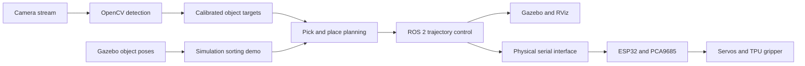

# Autonomous Sorting Robotic Arm

A servo-driven robotic arm for sorting black and white cubes, combining ROS 2, MoveIt 2, Gazebo and OpenCV with ESP32/PCA9685 control.

**Status:** six-cube sorting demonstrated in Gazebo. Physical autonomous sorting was reported by the project owner on a later laptop setup; those changes and that run are outside this repository snapshot.



The camera and Gazebo paths have separate readiness requirements. The recorded simulation uses object ground truth and simulated grasp attachments.

A low-cost, six-DOF robotic arm project for identifying 20 mm black and white cubes and sorting them into two bins. The arm uses a servo-driven rack-and-pinion adaptive gripper: the rack moves the fingers together to grasp or release an object.

**Reported bill of materials: ₹5,500.** Cost is the project team's reported component total and may exclude a PC/phone, tools, or consumables.

## Project state represented here

This repository records the project files and evidence from the original development laptop, before integration changes made later on a second laptop. It includes the ROS 2 / MoveIt 2 / Gazebo simulation, RViz setup, robot description, embedded servo-control firmware, OpenCV camera work, calibration attempts, and the learning experiments.

The six-cube Gazebo run is documented and reproducible. The project owner later reported that the adapted setup sorted cubes autonomously on the physical arm using a different laptop. Those later changes and that physical run are not part of this snapshot and have not been independently verified here. See [the project report](docs/PROJECT_REPORT.md) for evidence and limits.

## 1. Software stack

- ROS 2 Jazzy, MoveIt 2, `ros2_control`, Gazebo, RViz, URDF and Xacro
- OpenCV and a Redmi Note 13 video stream for image-based cube detection and calibration work
- ESP32 and PCA9685 PWM servo driver, with Arduino C++ firmware
- Python for vision, kinematics helpers, orchestration, tests, and Q-learning experiments

## 2. Run the simulation

On Ubuntu 24.04 with ROS 2 Jazzy and the project dependencies installed:

```bash
bash scripts/build.sh
bash scripts/start_simulation.sh gazebo sorting:=true
```

For the autonomous seeded sorting demo and run logs:

```bash
bash autonomous/start.sh --learn
```

The simulator uses Gazebo object ground truth and simulated grasp attachments. It is not the real camera pipeline. See [autonomous simulation instructions](autonomous/README.md) and [validation evidence](autonomous/VALIDATION.md).

## 3. Repository layout

- `ros2_ws/src/arm_simulation/` — robot description, simulation world, controller and MoveIt configuration
- `ros2_ws/src/arm_sorter/` — ROS 2 sorting and validation code
- `autonomous/` — simulation runner, learning policy, vision contract and calibration code
- `opencv_boxes/` — OpenCV colour/shape detection and camera scripts
- `firmware/` — ESP32/PCA9685 firmware and required library sources
- `hardware/stl/` — the owner-provided arm and gripper STL parts
- `live_trial/` — physical serial mirror utilities and target-planning helpers
- `model/`, `sorting/`, `reinforcement_learning/` — geometry, layouts and learning experiments
- `docs/` — project report, resume summary, and architecture notes

## 4. Hardware and controls

The arm has six commanded servo functions. The gripper is a rack-and-pinion mechanism with adaptive TPU fingers. The project configuration used an ESP32, PCA9685, three 20 kg servos and three MG996R servos. The channels recorded in the project are 0, 1, 2, 5, 6 and 7. See `hardware-details.md`, `ros2_ws/src/arm_simulation/config/geometry.yaml`, and `firmware/` for the snapshot settings.

A prepared firmware setting or a Gazebo success does not by itself certify safe physical execution. Review the current hardware, calibration, and stopping behavior before adapting this code to another arm.

## 5. Verification and commissioning

See [VERIFICATION.md](VERIFICATION.md) for an index of the dated validation records. The 2 November record reports 19 tests, a six-cube simulation episode and an active-motion STOP check. These historical results have not been rerun for this documentation update.

The production firmware paths are `firmware/live_trial/` and `firmware/virtual_pick/`. All six commanded channels, including the gripper, use nominal 90° startup and successful-task home. A persistent STOP latch takes priority; `HOME90` is explicit operator recovery. Startup commands position without measuring physical joint angles. The controller has no servo-power rail sensor.

Physical grasps command the existing full-close endpoint at 0° on channel 7 and hold it through transfer; release and home use 90°. Review [the home policy](hardware/HOME90_POLICY.md), current calibration and [hardware details](hardware-details.md) before commissioning.

`hardware/stl/` contains the supplied printable parts. [BOM.md](BOM.md) is an empty itemized bill of materials placeholder; the reported ₹5,500 total above has not been independently costed.

## 6. Local configuration

Camera IP addresses, local Wi-Fi values, captured images, build products, caches, and compiled firmware are not included. Configure the camera stream URL locally in `autonomous/camera_config.json`. Keep local credentials out of Git.

## 7. Project links

Use this project URL on LinkedIn, a portfolio or a resume:

https://github.com/aryanb1032/autonomous-sorting-robot-arm

Suggested title: **Autonomous Sorting Robotic Arm — ROS 2, MoveIt 2, OpenCV and ESP32**.

See [docs/RESUME.md](docs/RESUME.md) for the existing resume entry and [docs/PROJECT_REPORT.md](docs/PROJECT_REPORT.md) for the development record.
